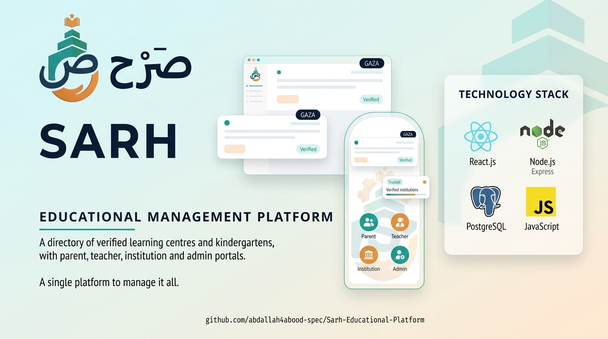
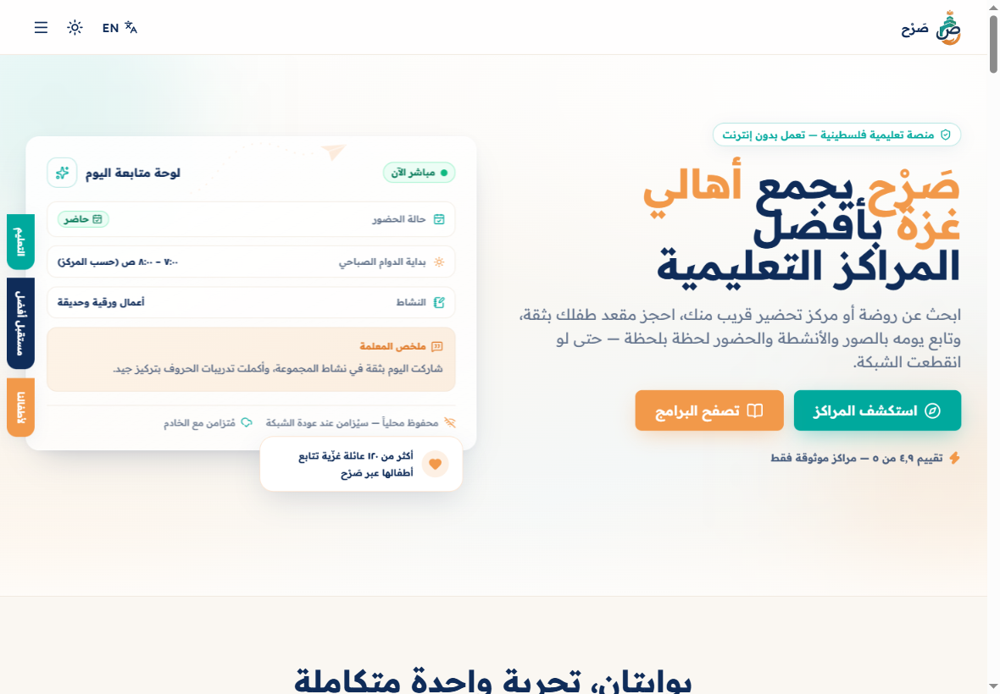
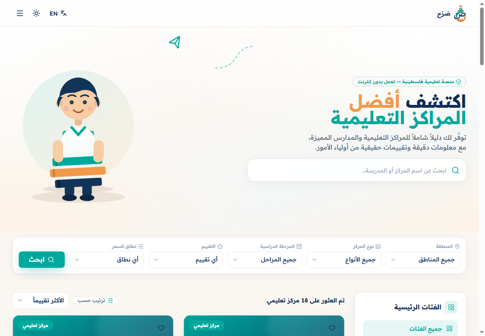
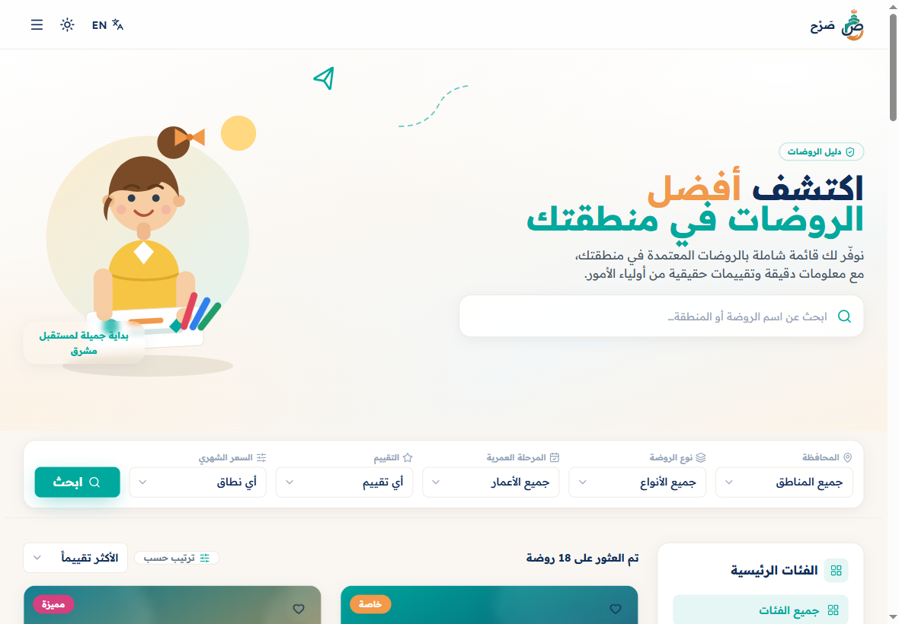
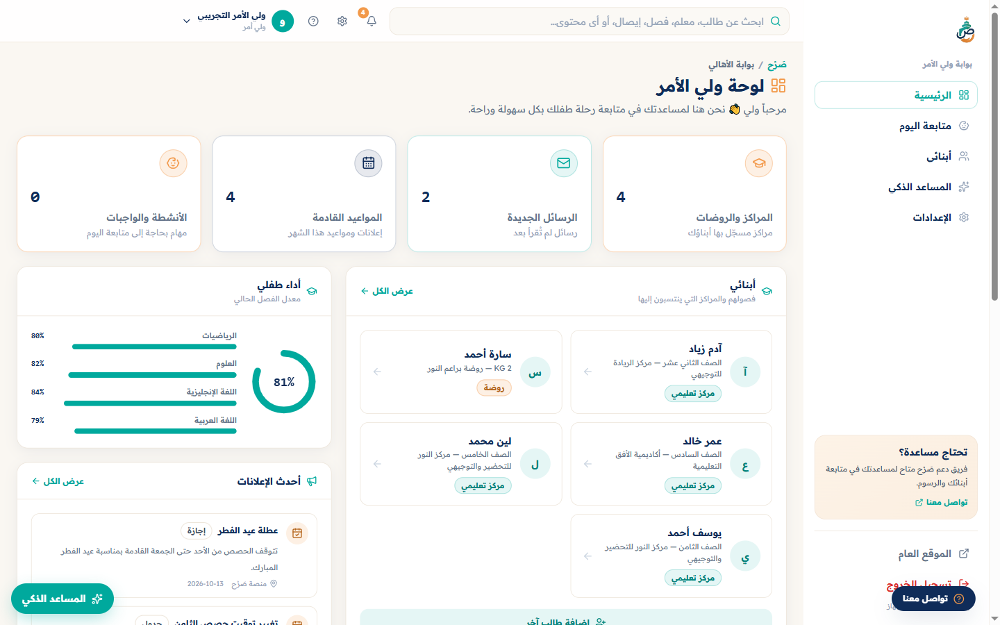
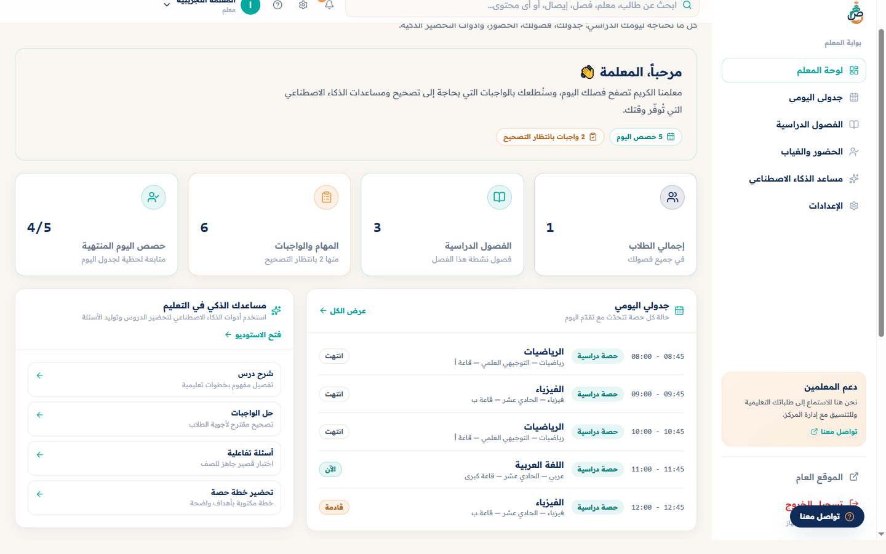
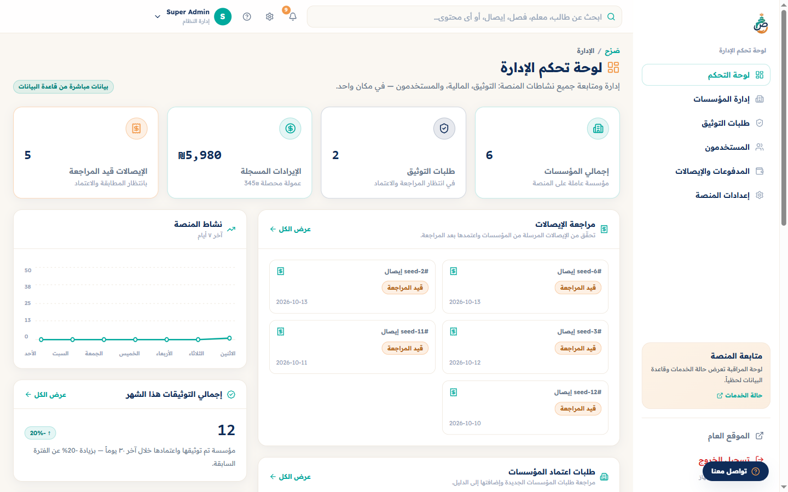

<p align="center">
  
</p>

<h1 align="center">SARH · صَرْح</h1>

<p align="center">
  A web platform that connects families in Gaza with learning centres and kindergartens —
  discovery, enrolment, daily follow-up, and the back-office tools each side needs.
</p>

<p align="center">
  <em>Status: active development (Phases 1–5 in place, hardening in progress). No live demo is published yet.</em>
</p>

---

## Table of contents

- [Project overview](#project-overview)
- [Screenshots](#screenshots)
- [Key features](#key-features)
- [User roles and portals](#user-roles-and-portals)
- [Technology stack](#technology-stack)
- [Architecture overview](#architecture-overview)
- [Project structure](#project-structure)
- [Prerequisites](#prerequisites)
- [Installation and setup](#installation-and-setup)
- [Environment variables](#environment-variables)
- [Database setup](#database-setup)
- [Running the application](#running-the-application)
- [Testing and validation](#testing-and-validation)
- [Security notes](#security-notes)
- [Project status](#project-status)
- [Roadmap](#roadmap)
- [License](#license)

---

## Project overview

SARH (صَرْح, "edifice") is an Arabic-first, RTL-native platform built around the two sides of
after-school and early-years education:

- **Families** need to find a trustworthy centre or kindergarten, enrol a child, and stay close
  to what happens during the day — attendance, activities, homework, fees and announcements.
- **Centres** need enrolment, staff, timetable, fee reconciliation and parent communication in
  one place, without a second system to maintain.

The platform is organised as five role-scoped portals on top of one public directory, one
PostgreSQL schema, and a small Python service that powers the assistant, quiz generation,
receipt OCR and daily-log summaries. The interface is designed Arabic-first (RTL) with an
English (LTR) mode, and the whole thing is built to stay usable on a constrained network:
installable PWA, offline attendance queue, and AI features that degrade to deterministic local
output when no model key is configured.

> **About the screenshots and demo data:** every name, phone number, grade and receipt in the
> screenshots below comes from `prisma/seed.ts`, which creates fictional demo personas
> ("ولي الأمر التجريبي", "المعلمة التجريبية", …). No real family, child or centre data is used.

---

## Screenshots

Real captures from the running application (`npm run dev`), seeded with the demo dataset.
Captured in Arabic/RTL, the product's default language.

### Home page

The public landing page introduces the two portals and links into the directory.



### Learning centres directory — `/explore/centers`

Filter by region, centre type, stage, rating and price range, then sort and paginate.



### Kindergartens directory — `/explore/kindergartens`

The kindergarten taxonomy has its own filters (age stage, monthly price) and hero.



### Parent portal — `/parent`

Children, centres, messages, announcements, the current-term performance summary and a link
into the AI study assistant.



### Teacher portal — `/teacher`

Today's timetable with live lesson state, classes with plan progress and attendance rate,
homework counts, and shortcuts into the AI studio.



### Admin portal — `/admin`

Verification queue, financial totals, receipt reconciliation, institution approvals, platform
activity and user counts by tier.



> The signed-out header's sign-in buttons are cramped at desktop widths and their labels spill
> outside the button boxes; that is a real UI-polish item in the app, not a capture artefact.
> The dashboards were captured at 1440×900, the public pages at 1180×820 (where the compact
> header renders cleanly).

---

## Key features

Legend: **Done** = implemented and reachable in the running app · **Demo** = works but is fed by
the seeded dataset or curated fixtures rather than production data · **Partial** = present but
not yet complete end-to-end.

### Public site and discovery

| Feature | Status | Notes |
| --- | --- | --- |
| Arabic-first landing page with bilingual (AR/EN) copy and RTL/LTR switching | Done | `LanguageProvider` + `src/lib/i18n/*` |
| Directory hub with dedicated `/explore/centers` and `/explore/kindergartens` routes | Done | |
| Search, region / category / stage / rating / price filters, sorting and pagination | Done | Client-side pipeline in `directory-view.tsx`; listings come from a bundled catalogue (`src/lib/data/directory.ts`) |
| Institution profile page `/center/[id]` | Done | Reads the `Institution` row from PostgreSQL; unknown ids return `notFound()` |
| Enrolment request modal on the centre page | Partial | The UI and validation exist; there is no enrolment API route yet |
| Teachers academy, about, FAQ, contact, privacy and terms pages | Done | Contact form posts to `/api/contact`; newsletter to `/api/newsletter` |

### Accounts, auth and access control

| Feature | Status | Notes |
| --- | --- | --- |
| Credentials sign-up / sign-in with email **or** phone identifier | Done | `bcryptjs` cost 12, identifier normalisation in `src/lib/identifier.ts` |
| Email verification and password reset | Done | Resend when `RESEND_API_KEY` is set, otherwise the link is logged server-side |
| Optional Google OAuth | Done | Enabled only when both Google env vars are present |
| Role-based portal guard in middleware | Done | Single registry in `src/lib/roles.ts`; JSON 401/403 for API routes, 308 for legacy URLs |
| Multi-role accounts (e.g. teacher who also supervises) | Done | `User.roles` array + effective-role helpers |

### Parent portal

| Feature | Status | Notes |
| --- | --- | --- |
| Dashboard: children, centres, unread messages, upcoming events, performance | Demo | Prisma-backed reads (`src/lib/db/parent.ts`) over the seeded dataset |
| Child daily feed (activities, photos, attendance, teacher notes) | Done | `/parent/feed` |
| AI study assistant chat | Done | `/parent/assistant` → `/api/parent/ai-chat` → FastAPI `/api/ai/chat` |
| Children management | Demo | `/parent/children` |

### Teacher portal

| Feature | Status | Notes |
| --- | --- | --- |
| Today's timetable with per-lesson state | Demo | `/teacher/schedule` |
| Classes, plan progress and attendance rate | Demo | `/teacher/classes` |
| Attendance capture with offline queue and background sync | Done | Dexie (`src/lib/offline/db.ts`) + `useOfflineSync` |
| AI studio: quiz generation, lesson explanation, homework feedback | Done | `/teacher/ai-studio` → FastAPI `/api/ai/generate-quiz` |

### Supervisor portal

| Feature | Status | Notes |
| --- | --- | --- |
| Overview, plan review queue and teacher evaluations | Demo | `/supervisor`, `/supervisor/plans`, `/supervisor/evaluations` |
| Teacher roster within the supervisor's scope | Demo | `/supervisor/teachers` |

### Institution portal

| Feature | Status | Notes |
| --- | --- | --- |
| Centre dashboard, enrolments, staff and profile | Demo | `/institution/**`, reads via `src/lib/db/institution.ts` |
| AI studio for centre staff, including attendance tooling | Done | `/institution/ai-studio` |

### Admin portal

| Feature | Status | Notes |
| --- | --- | --- |
| Verification / trust queue for institutions | Done | `/admin/trust`, `PATCH /api/admin/institutions/[id]/trust` |
| Institution directory and user management | Demo | `/admin/institutions`, `/admin/users` |
| Finance: transactions and approvals | Done | `/admin/finance`, `PATCH /api/admin/transactions/[id]` |
| Receipt OCR reconciliation | Done | `POST /api/ai/ocr-receipt` through the FastAPI service |
| Platform settings (contact details, feature copy) | Done | `SiteSetting` rows, `/admin/settings`, `GET` / `PATCH` / `POST` on `/api/settings` |

### Cross-cutting

| Feature | Status | Notes |
| --- | --- | --- |
| PWA install + offline shell | Done | `next-pwa` (disabled in development), `/offline` fallback page |
| Dark / light theme | Done | `next-themes` |
| Motion and smooth scrolling | Done | `framer-motion`, GSAP, Lenis (respects reduced-motion) |
| Automated tests | **Not present** | See [Testing and validation](#testing-and-validation) |

---

## User roles and portals

`prisma/schema.prisma` defines five tiers, and `src/lib/roles.ts` maps each one to exactly one
portal. The middleware, the sign-in redirect, the navbar role switcher and the dashboard sidebar
all read that same table, so a route cannot drift away from its role.

| Role | Portal | What it can reach |
| --- | --- | --- |
| `PARENT` | `/parent` | Children, daily feed, messages, announcements, AI assistant |
| `TEACHER` | `/teacher` | Timetable, classes, attendance, AI studio |
| `SUPERVISOR` | `/supervisor` | Plan review, teacher evaluations, roster in scope |
| `INSTITUTION_TEACHER` | `/institution` | Centre enrolments, staff, profile, centre AI studio |
| `SUPER_ADMIN` | `/admin` | Verification queue, finance, users, institutions, platform settings — plus every other portal for inspection |

Accounts can hold more than one tier (`User.roles`); the effective set is computed once and reused
everywhere.

---

## Technology stack

Confirmed from `package.json`, `prisma/schema.prisma`, `next.config.mjs` and
`ai_service/requirements.txt`.

**Frontend**

- Next.js `14.2` (App Router, Server Components) and React `18`
- TypeScript `5`, Tailwind CSS `3.4` with a custom `sarh` design-token palette
- `framer-motion`, GSAP (`@gsap/react`), Lenis, `lucide-react`, `next-themes`
- `react-hook-form` + `zod` + `@hookform/resolvers` for forms and validation
- `next-pwa` for the installable/offline shell, Dexie for the local attendance queue

**Backend (Next.js route handlers)**

- NextAuth `4` (`next-auth`) with a credentials provider and an optional Google provider
- Prisma `6` + `@prisma/client` over PostgreSQL
- `bcryptjs` for password hashing; Resend (HTTP API) for transactional email

**AI microservice**

- Python 3.11+, FastAPI `0.115`, Uvicorn, Pydantic v2, httpx
- Pillow for receipt image handling, optional `pytesseract` (needs the `tesseract` binary)
- Provider-agnostic: OpenAI, Anthropic or Google Gemini when a key is configured; otherwise
  deterministic local generators

**Tooling**

- ESLint (`next lint`), `tsc --noEmit`, `tsx` for running the seed script

---

## Architecture overview

```
Browser (RTL/LTR, PWA)
   │
   ├── Public pages  ──────────────► Next.js Server Components
   │                                   ├── bundled catalogue (src/lib/data/directory.ts)
   │                                   └── Prisma ──► PostgreSQL   (/center/[id], site settings)
   │
   ├── Five portals ───────────────► Next.js Server Components
   │        │                          └── Prisma ──► PostgreSQL   (src/lib/db/*)
   │        └── forms / mutations ──► Next.js route handlers  (/api/**)
   │                                    ├── NextAuth session + RBAC middleware
   │                                    └── Prisma ──► PostgreSQL
   │
   └── AI screens ─────────────────► /api/parent/ai-chat   (server proxy)
                                     └── FastAPI service (ai_service/)
                                           ├── /api/ai/generate-quiz
                                           ├── /api/ai/ocr-receipt
                                           ├── /api/ai/summarize-log
                                           └── /api/ai/chat
                                                 └── OpenAI | Anthropic | Gemini | local fallback
```

Notes on the actual wiring:

- **One schema, one client.** All reads and writes go through `src/lib/prisma.ts`
  (a singleton `PrismaClient`) and the per-domain modules in `src/lib/db/`
  (`parent`, `teacher`, `supervisor`, `institution`, `admin`, `finance`).
- **Auth is enforced twice.** `src/middleware.ts` guards routes at the edge; route handlers and
  server components re-check the session before touching data.
- **The AI service is optional at runtime.** The browser calls it directly for quiz generation and
  receipt OCR (`NEXT_PUBLIC_FASTAPI_URL`), while the parent assistant goes through the Next.js
  proxy at `/api/parent/ai-chat` (server-side `FASTAPI_URL`). When the service or a model key is
  missing, the deterministic local generators keep the endpoints answering.
- **Offline is a first-class path.** Attendance writes land in IndexedDB through Dexie and are
  flushed by `useOfflineSync` when connectivity returns; `next-pwa` serves the app shell and an
  `/offline` page.

---

## Project structure

```
Sarh_project/
├── prisma/
│   ├── schema.prisma          # 20 models + 9 enums: users, institutions, students,
│   │                          # enrolments, payments, quizzes, classes, plans, evaluations…
│   └── seed.ts                # deterministic demo dataset (refuses production by default)
├── src/
│   ├── app/
│   │   ├── (public)/          # landing, explore/*, center/[id], about, faq, contact,
│   │   │                      # teachers-academy, privacy, terms
│   │   ├── (portal)/          # parent · teacher · supervisor · institution · admin
│   │   ├── (auth)/            # legacy sign-in/sign-up screens
│   │   ├── auth/              # current sign-in, sign-up, forgot/reset password flows
│   │   ├── api/               # route handlers (auth, admin, parent, contact, newsletter, settings)
│   │   ├── offline/           # PWA offline fallback
│   │   └── globals.css        # design tokens, RTL rules, surface treatments
│   ├── components/
│   │   ├── directory/         # filters, cards, hero, pagination
│   │   ├── portal/            # shell, chrome, nav config, shared primitives
│   │   ├── sections/          # marketing sections
│   │   ├── ai/                # quiz generator, attendance tracker
│   │   ├── auth/ · layout/ · providers/ · ui/
│   ├── lib/
│   │   ├── db/                # Prisma query modules per domain
│   │   ├── data/              # curated catalogue + demo fixtures
│   │   ├── i18n/              # AR/EN dictionaries and the language provider
│   │   ├── offline/           # Dexie database
│   │   ├── roles.ts           # single role → portal registry
│   │   ├── auth.ts            # NextAuth options
│   │   └── prisma.ts          # PrismaClient singleton
│   ├── hooks/ · types/ · middleware.ts
├── ai_service/                # FastAPI microservice
│   ├── main.py                # app + CORS + health
│   ├── routers/               # quiz · ocr · summary · chat
│   ├── schemas.py · llm.py · config.py
│   └── requirements.txt
├── public/                    # brand assets, PWA icons, manifest
└── docs/images/               # README cover and screenshots
```

---

## Prerequisites

- **Node.js 18.17+** and npm (the project uses `package-lock.json`)
- **PostgreSQL 14+** reachable from your machine
- **Python 3.11+** with `pip` — only if you want the AI microservice
- Optional: a Tesseract binary on the host for local OCR, and an OpenAI / Anthropic / Gemini key
  if you want model-backed AI instead of the offline generators

---

## Installation and setup

```bash
# 1. Clone
git clone https://github.com/abdallah4abood-spec/Sarh-Educational-Platform.git
cd Sarh-Educational-Platform

# 2. Install dependencies (lockfile is committed)
npm install

# 3. Configure the environment
cp .env.example .env
#    → edit DATABASE_URL, NEXTAUTH_SECRET, NEXT_PUBLIC_APP_URL

# 4. Create the schema and load the demo dataset
npm run prisma:generate
npm run db:push
npm run db:seed

# 5. Start the app
npm run dev            # http://localhost:3000
```

The seed script creates one demo account per tier. **All of them share the same demo password**
(written in `prisma/seed.ts`) — treat these accounts as development-only and never deploy them.
Emails: `parent@sarh.ps`, `teacher@sarh.ps`, `supervisor@sarh.ps`, `center@sarh.ps`,
`admin@sarh.ps` (there are a few extra fixtures such as `parent2@sarh.ps`).

---

## Environment variables

Based on [`.env.example`](.env.example). Copy it to `.env`; never commit `.env`.

| Variable | Required | Purpose |
| --- | --- | --- |
| `DATABASE_URL` | Yes | PostgreSQL connection string used by Prisma |
| `NEXTAUTH_URL` | Yes | Canonical URL of the app (auth callbacks) |
| `NEXTAUTH_SECRET` | Yes | Signing secret for session tokens — generate a long random value |
| `NEXT_PUBLIC_APP_URL` | Yes | Absolute origin used in email links and OAuth callbacks |
| `GOOGLE_CLIENT_ID` / `GOOGLE_CLIENT_SECRET` | No | Enables the Google provider when both are set |
| `RESEND_API_KEY` | No | Sends verification/reset email; without it the link is logged server-side |
| `EMAIL_FROM` | No | Sender address; must be verified in Resend |
| `NEXT_PUBLIC_SUPPORT_PHONE` / `_WHATSAPP` / `_EMAIL` / `_SITE_LOCATION` | No | Fallbacks when the DB-backed `SiteSetting` value is empty |
| `NEXT_PUBLIC_FASTAPI_URL` | No | AI service URL used by browser-side AI screens |
| `FASTAPI_URL` | No | Server-side AI service URL for the parent chat proxy (falls back to the public value) |
| `NEXT_PUBLIC_SOCIAL_*`, `NEXT_PUBLIC_INTRO_VIDEO_URL` | No | Optional footer links / intro video; empty values render nothing |
| `SEED_FORCE` | No | `1` allows re-seeding demo accounts in production (guarded by design) |

The AI microservice reads its own variables from `ai_service/.env`:
`OPENAI_API_KEY` / `OPENAI_MODEL`, `ANTHROPIC_API_KEY` / `ANTHROPIC_MODEL`,
`GEMINI_API_KEY` / `GEMINI_MODEL`, `ALLOWED_ORIGINS`, `AI_SERVICE_HOST`, `AI_SERVICE_PORT`,
`AI_REQUEST_TIMEOUT`. With no key set the service reports `local` as the active provider.

---

## Database setup

- **Engine:** PostgreSQL. **ORM:** Prisma 6. **Schema:** [`prisma/schema.prisma`](prisma/schema.prisma)
  (users, institutions, students, enrolments, daily logs, payments, quizzes, classes, timetable
  slots, staff, lesson plans, evaluations, quality signals, announcements, messages, subject
  performance, activity events, directory checklists, site settings, verification tokens).
- **Migration status — read this before deploying:** the repository has **no `prisma/migrations`
  directory**. The intended local workflow is `npm run db:push`, which applies the schema directly
  and keeps no history. If you plan to run this against a real database, generate a baseline
  migration first:

  ```bash
  npx prisma migrate dev --name init
  ```

  Until that is done, `prisma migrate deploy` has nothing to replay.
- **Seeding:** `npm run db:seed` runs `prisma/seed.ts` (via `tsx`). It is deterministic and
  idempotent, repairs demo passwords on re-run, and refuses to overwrite demo accounts when
  `NODE_ENV=production` unless `SEED_FORCE=1`.
- **Inspect data:** `npm run prisma:studio`.

Nothing in this repository runs migrations, resets or truncates automatically.

---

## Running the application

```bash
# Web app (Next.js) — http://localhost:3000
npm run dev

# Production build
npm run build && npm start
```

```bash
# AI microservice — http://localhost:8000 (docs at /docs)
cd ai_service
python -m venv .venv
source .venv/Scripts/activate     # Windows (Git Bash); use .venv/bin/activate on macOS/Linux
pip install -r requirements.txt
uvicorn main:app --reload --port 8000
```

Health check: `GET http://localhost:8000/api/ai/health` reports the service status and the active
LLM provider (`local` when no key is configured). The web app works without this service — only
the AI screens need it.

---

## Testing and validation

There is **no automated test suite** in this repository yet: no `test` script, no test runner
dependency, and no `*.test.*` / `*.spec.*` files. Please don't assume CI coverage.

The checks that exist today:

```bash
npm run typecheck   # tsc --noEmit
npm run lint        # next lint
npm run build       # production build
```

Manual validation that is worth doing after a change:

1. Sign in with each seeded account and confirm you land on the right portal and cannot open
   another tier's routes directly.
2. Visit a centre profile with a valid id and with an unknown id (expect `404`).
3. Toggle the language switch and confirm the layout mirrors correctly.
4. Turn off the network after capturing attendance and confirm the queued write flushes when the
   connection returns.
5. Call the AI endpoints with no provider key configured and confirm they still answer locally.

---

## Security notes

- **Never commit `.env`.** Only `.env.example` is tracked. `NEXTAUTH_SECRET` must be replaced with a
  long random value; the placeholder in the example file is not a secret.
- **Demo credentials are public.** `prisma/seed.ts` contains one shared demo password for every
  seeded account. Change or delete those accounts before any shared/production deployment.
- **Role checks are enforced server-side**, in `src/middleware.ts` and again in the route handlers
  and server components. Client-side hiding of navigation is not treated as a security boundary.
- **Receipt uploads and OCR** are processed by the AI service; keys for OpenAI / Anthropic / Gemini
  belong in the service's environment, never in the Next.js public variables.
- **CORS on the AI service** is an explicit allow-list (`ALLOWED_ORIGINS`). Keep it narrow; do not
  add `*` alongside `allow_credentials`.
- **Seed guard:** production seeding is blocked unless you deliberately set `SEED_FORCE=1`.
- **Known gap:** the enrolment request form on `/center/[id]` has no API route yet, so it does not
  persist anything — it must not be described or relied on as a working submission path.

---

## Project status

The project is **under active development**. The public site, authentication, RBAC, the five portal
shells and the AI microservice are in place, and several portals are already reading and writing
through Prisma. What is not finished:

- No automated tests and no CI pipeline.
- No migration history (schema applied with `db:push`); this needs a baseline migration before a
  production deployment.
- Some portal screens are still driven by curated demo fixtures rather than real workflows
  (marked **Demo** in [Key features](#key-features)).
- Enrolment submission, and a few admin/institution actions, are UI-complete but not API-complete.
- No live/public deployment is published, so no demo URL is linked here.
- Desktop header polish on the signed-out public pages (compact sign-in actions).

---

## Roadmap

Directional and unscheduled — items here are not implemented yet.

- Add a test suite (unit + a smoke path per portal) and wire it into CI.
- Replace `db:push` with a proper baseline migration and a deploy-time migrate step.
- Finish the enrolment flow end to end (API route, notifications, institution-side approval).
- Move the Explore directory onto PostgreSQL reads once the institution data model is settled.
- Add rate limiting and audit logging to the admin and AI proxy routes.
- Harden the PWA/offline story with a real conflict-resolution rule for queued attendance.
- Ship an accessibility and RTL pass across the portals.

---

## License

No license file is present in this repository, so the license is **not specified**. The code is
published for viewing and review; absent an explicit license, no usage, modification or
redistribution rights are granted. If you need to use this project, contact the repository owner
first.

---

<p align="center">
  <sub>SARH · صَرْح — built for families, teachers and learning centres in Gaza.</sub>
</p>
